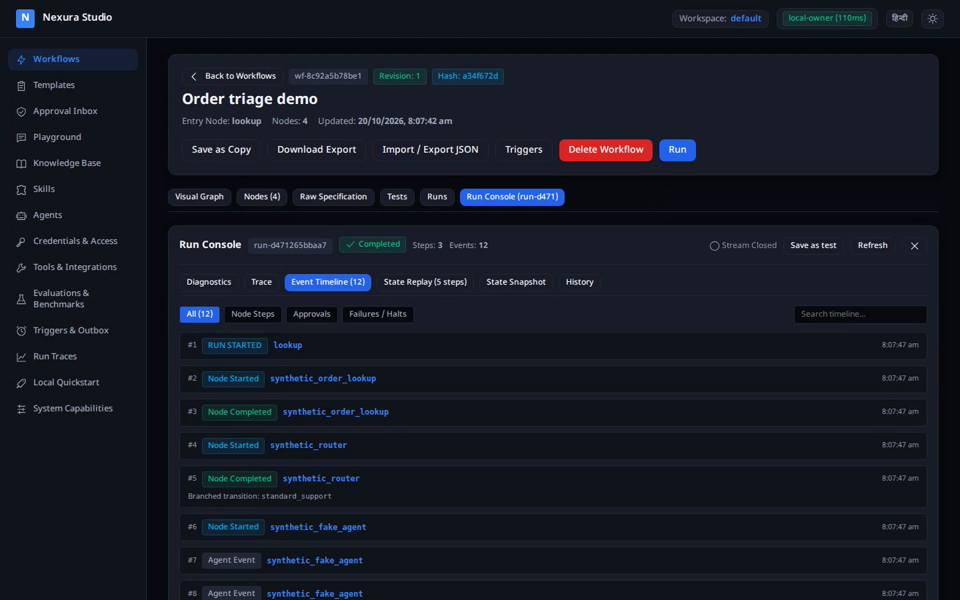
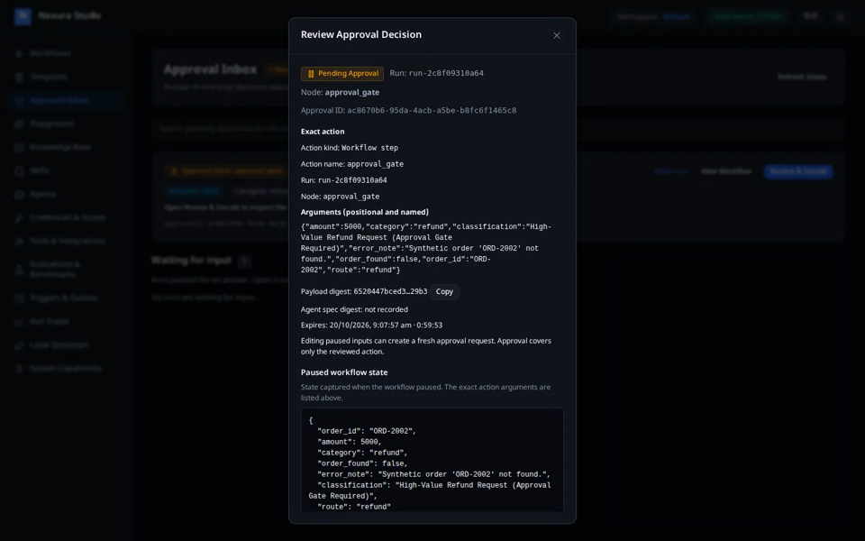
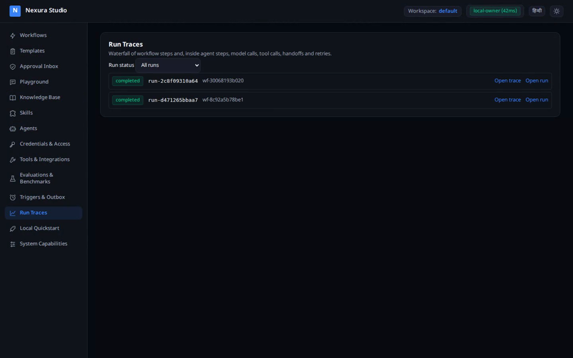

# Nexura

Nexura is a typed Python SDK for operational agents and approval-gated workflows, with an optional local REST service, TypeScript API client and browser Studio. Use `nexura-agents` for the standalone agent SDK (just `httpx` and `pydantic`), or `nexura-runtime` for durable workflows, RAG, evaluations and the service. Python runs the workflows; Studio and the TypeScript client use the same API.

## Review the exact action

Pause before a risky tool or workflow step and review its resolved inputs. Approval is bound to the action digest and expiry; editing the inputs requires a fresh approval, and a decision cannot be used twice. See [Human approval](docs/approvals.md) for the supported paths and limits.

## Reproduce a failure offline

Export a recorded run and replay it with scripted models and tool fixtures, without provider keys. Recordings use best-effort redaction of known secret shapes; review every bundle before sharing it. See [Reproducing failures](docs/reproducing-failures.md).

## Control shared spending

Agents and workflow steps can share a budget that reserves estimated cost before dispatch. Unknown usage and prices stay unknown; this is admission control, not a provider-invoice ceiling, and actual billed usage can exceed an estimate before later calls are refused. See [Budgets and usage](docs/budgets-and-usage.md).

## Install

**Alpha (0.4), not published:** nothing is on PyPI or npm yet. Start from a source checkout with Python 3.12:

```bash
git clone https://github.com/Liceron/nexura
cd nexura
uv sync
uv build --all-packages
```

Install locally built wheels with the commands below, from the checkout. Each Python package is independent; the runtime does not require every add-on. The TypeScript package is an HTTP client, with no runtime of its own.

| Package | Purpose | Install from local artifacts |
|---|---|---|
| `nexura-agents` | Standalone agents, tools, teams, providers | `pip install --no-index --find-links dist nexura-agents` |
| `nexura-runtime` | Durable workflows, RAG, evaluations | `pip install --no-index --find-links dist nexura-runtime` |
| `nexura-connectors` | 15 SaaS/database/mail workflow connectors | `pip install --no-index --find-links dist nexura-connectors` |
| `nexura-postgres` | PostgreSQL storage and pgvector | `pip install --no-index --find-links dist nexura-postgres` |
| `nexura-qdrant` | Qdrant vector store | `pip install --no-index --find-links dist nexura-qdrant` |
| `nexura-sandbox` | WASI, bubblewrap and gVisor backends | `pip install --no-index --find-links dist nexura-sandbox` |
| `nexura-vertex` | Google Vertex AI provider | `pip install --no-index --find-links dist nexura-vertex` |
| `nexura-studio` | Older built-in Studio and launcher | `pip install --no-index --find-links dist nexura-studio` |
| `@liceron/nexura-sdk` | TypeScript REST API client | `npm install ./clients/typescript/liceron-nexura-sdk-0.4.0.tgz` |

The wheel commands assume dependencies are already installed or available in `dist/`; `uv build` does not collect dependency wheels. For the TypeScript artifact, first run `npm ci && npm run build && npm pack` in `clients/typescript`. See [Packages and installation](docs/packages.md) for dependencies, source installs and backend requirements.

Core runtime dependencies are `httpx`, `pydantic`, `packaging` and `cryptography`. Optional extras:

| Extra | Adds | Needed for |
|---|---|---|
| `studio` | fastapi, uvicorn | REST service, `serve`, `worker`, `create_api_app`; the older launcher is a separate package |
| `knowledge` | pypdf | PDF ingestion |
| `secrets` | (nothing; `cryptography` is core since 0.4.0) | Compatibility with old install commands |
| `sandbox` | pydantic-monty | Default Monty code-execution backend |

`nexura-agents[litellm]` adds LiteLLM and `nexura-agents[otel]` adds tracing. Use `nexura-sandbox[wasi]` for WASI. Earlier `postgres`, `vector`, `vertex` and `sandbox-wasi` extras became the separate packages above. Missing dependencies are reported as `MODULE_UNAVAILABLE` rather than silently skipped.

## Five-minute quickstart (keyless)

After `uv sync`, save this as `quickstart.py` and run `uv run python quickstart.py`. `FakeModel` is a deterministic local fake: no API keys or network calls.

```python
from nexura_runtime import Agent, FakeModel, Runner, ToolCall, tool


@tool
async def lookup_order(order_id: str) -> dict[str, str]:
    """Look up order delivery status."""
    return {"order_id": order_id, "status": "Out for Delivery"}


agent = Agent(
    name="SupportBot",
    instructions="You are a helpful customer support agent.",
    model=FakeModel(
        responses=[
            [ToolCall(id="call_1", name="lookup_order", arguments={"order_id": "ORD-101"})],
            "Order ORD-101 is out for delivery.",
        ]
    ),
    tools=[lookup_order],
)
result = Runner().run(agent, "Where is my order ORD-101?")
print(result.tool_calls_count, result.final_output)
```

Output: `1 Order ORD-101 is out for delivery.` To try approval next, save this independent example as `approval.py` and run `uv run python approval.py`:

```python
import asyncio
from nexura_runtime.workflow import (
    MemoryWorkflowStore, ModuleRegistry, WorkflowEngine, WorkflowNode, WorkflowSpec,
)

registry = ModuleRegistry()


@registry.register_handler("refund")
async def refund(state: dict) -> dict:
    return {"refund_id": "REF-9901"}  # local fake action, no payment is sent


async def main() -> None:
    spec = WorkflowSpec(
        name="Refund", entry_node="refund",
        nodes={"refund": WorkflowNode(id="refund", handler="refund", requires_approval=True)},
        terminal_nodes=["refund"],
    )
    engine = WorkflowEngine(spec, registry, store=MemoryWorkflowStore())
    paused = await engine.run({"order_id": "ORD-1"})
    print(paused.status)
    done = await engine.resume(
        paused.workflow_run_id, paused.pending_approval.approval_id, decision="approve",
    )
    print(done.status, done.state["refund_id"])


asyncio.run(main())
```

Output is `paused`, then `completed REF-9901`. The full [approval workflow tutorial](docs/workflows.md#tutorial-an-approval-gated-workflow) adds SQLite persistence and resumes through a new engine after a restart. [Getting started](docs/getting-started.md) covers async use and further keyless examples.

## Running Studio

Short recordings of the local Studio, offline with fake models (click a picture to play the video):

| Build and run a workflow, no API key | Review the exact action before approving | Agents, knowledge, traces, evaluations |
|---|---|---|
| [](docs/media/demo-build-and-run.mp4) | [](docs/media/demo-exact-action-approval.mp4) | [](docs/media/demo-studio-tour.mp4) |

From the source checkout, start the API and Studio in separate terminals:

```bash
uv sync --extra studio
uv run nexura-runtime serve --port 8765 --db ./nexura_service.sqlite3
```

```bash
cd studio-web
npm ci
npm run dev
```

Open the Vite URL printed in the second terminal. Studio proxies `/api` to `http://127.0.0.1:8765`; override with `VITE_BACKEND_URL`. Chat uses an offline fixture by default. The service uses the single-owner `local-owner` profile and loopback binding; do not expose it on a network as is.

For schedules, workers, model allowlists, streaming chat, exports, pending input and the older built-in Studio, see [Service and Studio](docs/studio-and-service.md).

## Two editions

| Edition | Includes | Boundary |
|---|---|---|
| MIT open source | Agents, workflows, local Studio/service, local credentials, approvals, budgets, sandbox safety, Langflow import/export and trace export | **single user, this machine only; for a team or a public endpoint use the hosted or enterprise edition** |
| [Enterprise](https://github.com/Liceron/nexura-enterprise) (private) | Authentication, workspace members, organisations/invites, hosted secrets and rotation, publishing/widget, Nexura V2 compatibility, client and Studio add-ons | Proprietary; no external security review; installing MIT packages alone does not enable these features |

Local workspaces organise one owner's projects; they are not tenant or member accounts. The open-source service has no account logins, authentication tokens or API keys. Even when embedded, `create_api_app()` refuses non-loopback peers and requires `X-Nexura-Session` for state-changing requests. The session token stops other web pages, not local programs on this machine, which can read it. An insecure network opt-in adds no authentication and does not make a public endpoint safe. A single-user local Docker setup is in `deployment/`.

## What is verified, and what is not

The latest recorded local gate, **2026-10-20**, reported **Ready: True, 21/21** required checks: **5110 Python tests + 89 browser tests**, on one machine. It included disposable Postgres/Qdrant, the real gVisor test profile, lint/types, keyless examples, external Python/TypeScript consumers, standalone installs of all eight packages, service load, Studio unit/build checks and the enforced edition boundary. This is a historical local result, not release approval, production readiness or security certification; this README edit does not rerun that gate.

Provider adapters are mock-verified except for owner-run **Vertex AI (Gemini 2.5 Flash), 2026-10-08** (reply, tool call, streaming) and **Gemini API, 2026-10-20** (reply, tool call, streaming, structured answer). OpenAI, Anthropic and Sarvam live checks have not run. LiteLLM is checked only with the real library's offline mock-response mode, not live providers.

| Component | Supported | Verified scope |
|---|---|---|
| Python | 3.12 only (`>=3.12,<3.13`) | Runtime on CPython 3.12.14 |
| `nexura-agents` alone | 3.11, 3.12, 3.13 (`>=3.11,<3.14`) | 295 SDK tests from wheels on 3.11 and 3.13, 2026-10-09; 4 platform-importing files excluded |
| Node.js | 24.x | Node 24.20.0, npm 11.19.0 |
| OS | Linux | x86_64, kernel 7.0; macOS and Windows untested |
| Storage | SQLite by default; Postgres/pgvector and Qdrant need services | SQLite and disposable local services; no managed-cloud claim |

CI is defined (including the SDK's Python matrix) but **remote CI has not yet run**. There has been **no external security audit/review**, including of the closed edition's shared-service path. Public MCP servers, live image calls and a real external MCP client app remain unverified. A2A supports JSON-RPC 1.0, with no push notifications, OAuth or gRPC.

Workflow JSON never contains code: only trusted registered handlers run. Approvals cover supported connector writes and gated nodes, bind resolved inputs (low-level gates also bind run/node/spec/action/payload, including positional tool arguments), enforce expiry on claim and before execution, refuse non-string mapping keys in canonical digests and return 409 for duplicate decisions. Plain `@tool` functions need `requires_approval=True`; Python setting `ExecutionContext.approval_granted` itself is trusted. Side-effecting handlers/tools are never retried automatically; a crash can leave their outcome uncertain, recorded rather than replayed. See [SECURITY_MODEL.md](SECURITY_MODEL.md) for controls and open gaps.

Historical fake-model measurements establish neither real-model quality, provider bills/cache savings, production scale, customer demand nor superiority over other frameworks. The older gate that skipped a required browser check remains documented separately. The approximately 135 ms SDK import on 2026-10-09 (Python 3.12, warm cache, lazy provider loading) is a single local measurement, not a benchmark. See the [verification record](docs/testing.md#verification-record) for the complete chronology and limitations.

Nothing has been published. Final package names still need registration and npm scope ownership needs confirmation; the [historical naming check](docs/testing.md#publication-and-naming) establishes no current availability. Copyright holder and security contact are set: Liceron, info@liceron.in.

## Documentation map

[Documentation index](docs/README.md): **34 guides** plus the generated [API reference](docs/api-reference.md). Offline Python examples are executed by tests; blocks needing a real model or running service are marked and skipped.

| Start with | Continue to |
|---|---|
| [Getting started](docs/getting-started.md) | [Agents](docs/agents.md), [tools](docs/tools.md), [teams](docs/teams.md), [structured output](docs/structured-output.md) |
| [Human approval](docs/approvals.md) | [Durable runs](docs/durable-runs.md), [reproducing failures](docs/reproducing-failures.md), [workflows](docs/workflows.md) (retries, input, forks, sub-workflows, parallel steps) |
| [Models and providers](docs/providers.md) | Vertex AI, LiteLLM, settings, retry/fallback; [budgets and usage](docs/budgets-and-usage.md) |
| [Service and Studio](docs/studio-and-service.md) | [Extending](docs/extensions.md), [local secrets](docs/local-secrets.md), [troubleshooting](docs/troubleshooting.md) |
| [Packages and installation](docs/packages.md) | Add-on backends and their caveats; [historical comparisons](docs/comparisons.md) |
| [Testing](docs/testing.md) | Verification history and public backend catalog |

## Contributing

See [CONTRIBUTING.md](CONTRIBUTING.md) for setup, test profiles and support/deprecation policy. Contributions require the [CLA](CLA.md): it is a draft awaiting lawyer review, and outside pull requests cannot be merged until the reviewed version is published. The automated CLA check is planned; current signing instructions are in the contributing guide.

```bash
uv run pytest
uv run ruff check src tests examples
uv run mypy src packages/*/src
```

## Security policy

Report vulnerabilities privately using [SECURITY.md](SECURITY.md) (info@liceron.in). Read the [security model](SECURITY_MODEL.md) before enabling tools, connectors or code execution.

## Licence

MIT. **Copyright (c) 2026 Liceron.** See [LICENSE](LICENSE) and [third-party notices](THIRD_PARTY.md).
